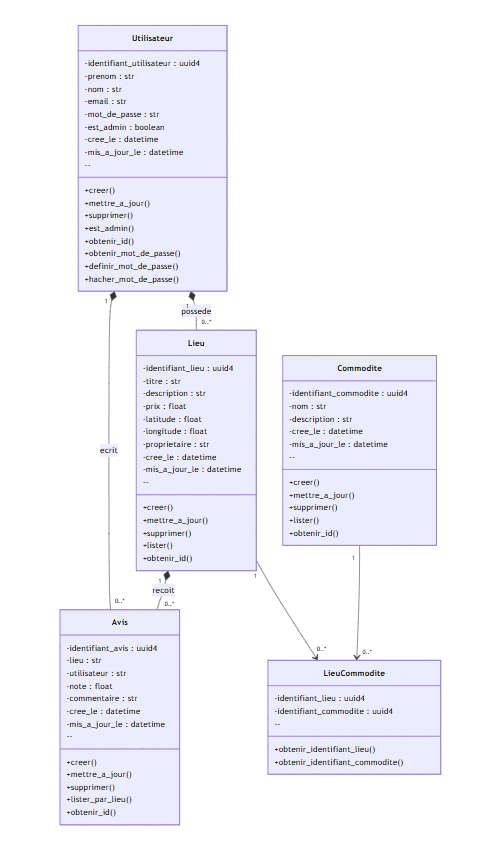
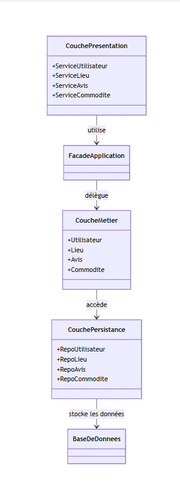

# HBnB

Projet Holberton School : conception et implémentation d'une application web de
location de logements entre particuliers (type Airbnb). Les utilisateurs peuvent
publier, rechercher et évaluer des lieux de séjour.

L'application suit une architecture en trois couches — **Présentation**,
**Logique métier** et **Persistance** — et le dépôt suit la progression du projet
en trois parties : documentation technique, implémentation de l'API, puis
persistance en base et authentification.

## Stack technique

- **Python** / **Flask** avec **flask-restx** pour les endpoints REST et la
  documentation Swagger
- **SQLAlchemy** (`flask_sqlalchemy`) pour la persistance, avec `init_db.py` pour
  l'initialisation du schéma
- **flask-jwt-extended** pour l'authentification JWT et **flask-bcrypt** pour le
  hachage des mots de passe
- **pytest** et **requests** pour les tests

## Structure du dépôt

```
part1/              documentation technique (UML)
  README.md         architecture en couches, diagrammes de packages,
                    de classes et de séquence
  images/           diagrammes (classes, packages, séquences)

part2/              logique métier et endpoints API
  app/              application Flask
    api/            endpoints flask-restx (v1)
    models/         modèles métier (User, Place, Review, Amenity)
  config.py         configuration
  run.py            point d'entrée
  test/             tests
  requirements.txt

part3/              persistance SQLAlchemy, authentification JWT et droits d'accès
  app/              application Flask
    api/            endpoints flask-restx (v1)
    models/         modèles de la couche métier
  init_db.py        création du schéma de base
  config.py         configuration
  run.py            point d'entrée
  tests/            tests
  ER_diagram.png    modèle entité-association
  requirements.txt
```

## Lancement

Chaque partie est autonome. Depuis `part2/` ou `part3/` :

```bash
python3 -m venv venv && source venv/bin/activate
pip install -r requirements.txt
python run.py
```

L'API démarre en mode debug sur http://localhost:5000 ; la documentation Swagger
est exposée par flask-restx.

Pour `part3`, initialiser la base avant le premier lancement :

```bash
python init_db.py
```

Lancer les tests :

```bash
pytest
```

## Documentation

Le dépôt n'a pas de dossier `documentation/` dédié : la documentation technique
constitue la partie 1 du projet, dans [`part1/README.md`](part1/README.md)
(architecture, diagrammes de packages, de classes et de séquence). Chaque partie
possède en complément son propre README :
[`part2/README.md`](part2/README.md), [`part3/README.md`](part3/README.md).

## Aperçu

| Diagramme de classes | Diagramme de packages |
|---|---|
|  |  |

## Mon rôle

`[à compléter]`

Le dépôt ne documente pas la répartition des contributions au sein de l'équipe.
